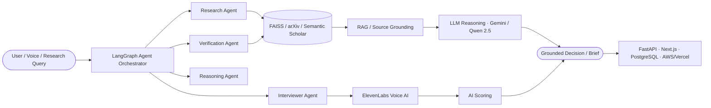

<!-- ╔══════════════════════════════════════════════════════════════════════╗ -->
<!-- ║                      SHRIANSH VIKRAM SINGH                            ║ -->
<!-- ║        AI Systems Engineer · Multi-Agent Architect · Founder          ║ -->
<!-- ╚══════════════════════════════════════════════════════════════════════╝ -->

<div align="center">

<!-- ══════════════════════ HERO BANNER ══════════════════════ -->


<!-- ══════════════════════ TYPING SVG ══════════════════════ -->

<a href="https://github.com/shriansh1625">

</a>

<!-- ══════════════════════ TOP BADGES ══════════════════════ -->

<p>


</p>

<p>
<a href="https://www.linkedin.com/in/shriansh-vikram-singh-8a7938231/"></a>
<a href="mailto:omshriansh16@gmail.com"></a>
<a href="https://github.com/shriansh1625"></a>
<a href="https://leetcode.com/u/ShrianshVikram_1625"></a>
</p>

</div>


<!-- ══════════════════════ INTRODUCTION ══════════════════════ -->

## `>` whoami

<div align="center">


</div>

<details open>
<summary><b>💻 Click to expand / collapse the terminal view</b></summary>

```python
class ShrianshVikramSingh:
    def __init__(self):
        self.role          = "AI Systems Engineer & Founder"
        self.specialties   = ["Multi-Agent Systems", "RAG", "Voice AI", "Cybersecurity", "Enterprise AI"]
        self.founded       = "SynapSoul Labs — AI Engineering Operating System"
        self.shipped       = "6 production AI Interview Agents on ElevenLabs Voice AI @ Procand"
        self.research      = "AI-based Fall Detection in IoT @ IBIoT Lab, MMMUT"
        self.recognition   = ["2nd / 1100+ teams @ IISc ArtPark ProtoDash", "Top 5 / 1500+ @ Zynd Aickathon"]
        self.readiness     = "98/100 Readiness Score · 47/47 modules · 6/6 skills verified"
        self.stack         = ["LangGraph", "LangChain", "FastAPI", "FAISS", "Next.js", "AWS", "Flutter"]
        self.mindset       = "Architect systems. Automate workflows. Ship to prod."

    def current_focus(self):
        return "Autonomous research agent orchestration + enterprise AI tooling"
```

</details>

> **AI Engineer with production experience** designing LLM-powered multi-agent systems, autonomous research platforms, voice-automated hiring pipelines, and retrieval-augmented architectures. Founder of **SynapSoul Labs**, Google Student Ambassador, national-level AI hackathon winner, applied AI researcher, and open-source contributor operating beyond the student level.


<!-- ══════════════════════ VERIFIED PROOF ══════════════════════ -->

## `>` Verified Hiring Proof

<div align="center">

**Public, hiring-facing proof profile — verified skills, completed builds, and readiness score.**

| 📊 Readiness Score | 📦 Live Builds | ✅ Completed | 🧾 Proof Cards |
|:---:|:---:|:---:|:---:|
| **98 / 100** (47/47 modules · 6/6 skills) | Active | **6** finished end-to-end | **10** built-work proof points |

**Status:** 🟢 Open to Opportunities · since Jul 16, 2026 · [View full profile → upsk.to/@shriansh1625](https://upsk.to/shriansh1625)

</div>


<!-- ══════════════════════ FOCUS AREAS ══════════════════════ -->

## `>` AI Engineering Focus Areas

<div align="center">

| 🧠 Multi-Agent Systems | 🔍 Retrieval-Augmented Generation | 🎙️ Voice AI |
|:---:|:---:|:---:|
| Autonomous agent orchestration via LangGraph, tool-use, decentralized AI swarms | Claim-level, citation-backed retrieval; hallucination reduction | Conversational intelligence, adaptive questioning, real-time STT |

| ⚡ Enterprise AI Tooling | ☁️ Cloud-Native AI | 🛡️ Cybersecurity |
|:---:|:---:|:---:|
| Agent Studio, RAG Studio, Prompt Lab, Dataset Studio, Eval Center | AWS-deployed AI apps, microservices, Vercel + Render CI/CD | CCNA-certified networking, Palo Alto network security fundamentals |

</div>


<!-- ══════════════════════ TECH STACK ══════════════════════ -->

## `>` Tech Stack

**AI / ML & Agents**


**Voice AI & Comms**


**Backend & APIs**


**Cloud & Infra**


**Frontend & Mobile**


**Databases**


**Networking & Security**


<!-- ══════════════════════ FEATURED PROJECTS ══════════════════════ -->

## `>` Featured Projects

<table>
<tr>
<td width="50%" valign="top">

### 🧠 SynaptiQ ResearchOS
**Autonomous Multi-Agent Research Platform**

> **Problem** — Research synthesis is slow, and LLMs hallucinate when reasoning over large corpora.
>
> **Architecture** — LangGraph orchestrates research, verification, reasoning, and executive-brief agents; claim-level verification runs against FAISS, Semantic Scholar, and arXiv for citation-backed output.
>
> **Stack** — `Python` · `FastAPI` · `LangGraph` · `FAISS` · `PostgreSQL` · `Next.js`
>
> **Impact** — Citation-backed, hallucination-resistant research briefs with automated knowledge-graph generation.
>
> **Innovation** — Presented at the **Capgemini Agentify AI 2026** competition with a full 12-slide technical deck.

</td>
<td width="50%" valign="top">

### 🧬 SynapSoul
**Enterprise AI Engineering Platform** · *Founder & AI Engineer*

> **Problem** — AI teams lack one integrated workspace to build, test, and ship agents and RAG pipelines.
>
> **Architecture** — Full-stack platform with 12 integrated modules — Agent Studio, RAG Studio, Prompt Lab, Dataset Studio, Experiment Tracker, and Evaluation Center — on a local-first IndexedDB architecture.
>
> **Stack** — `TypeScript` · `React` · `TanStack` · `OpenRouter` · `Qwen 2.5` · `Vercel`
>
> **Impact** — 53 automated tests, strict TypeScript, and Vercel CI/CD for reliable, production-quality delivery.
>
> **Innovation** — Now organized under **SynapSoul Labs**, with active repos including `synapsoulos`, `synapsoul-command`, and `trust-transparency-core`.

</td>
</tr>
<tr>
<td width="50%" valign="top">

### 🛡️ SwiftShield
**AI-Powered Micro-Insurance Platform**

> **Problem** — Micro-insurance lacks real-time risk pricing and fast, fraud-resistant claims.
>
> **Architecture** — FastAPI backend with a 7-day hyperlocal disruption risk engine, async WebSocket monitoring, automated Razorpay payouts, and XGBoost fraud scoring with duplicate-submission detection.
>
> **Stack** — `FastAPI` · `WebSockets` · `Razorpay API` · `XGBoost`
>
> **Impact** — Real-time risk scoring, automated claims, and fraud detection in one pipeline.
>
> **Innovation** — Live predictive risk engine fused with streaming fraud detection.

</td>
<td width="50%" valign="top">

### 🚑 Zynd Alpha
**Decentralized Multi-Agent AI Swarm** · *Top 5 / 1500+*

> **Problem** — Emergency medical dispatch is centralized, slow, and identity-fragile.
>
> **Architecture** — A decentralized multi-agent AI swarm coordinating LLM reasoning, voice intake, and image analysis, with Twilio comms and Polygon ID for verifiable identity.
>
> **Stack** — `LLMs` · `Voice AI` · `Image Analysis` · `Flutter` · `Twilio` · `Polygon ID`
>
> **Impact** — Autonomous emergency dispatch coordination across distributed agents.
>
> **Innovation** — Decentralized agent swarm for life-critical, real-time coordination.

</td>
</tr>
<tr>
<td width="50%" valign="top">

### 🤖 Multi-Agent AI Interview System
**Voice-Automated Hiring Pipeline** · *Production @ Procand*

> **Problem** — First-round screening is manual, slow, and inconsistent.
>
> **Architecture** — 6 specialized AI interview agents built on ElevenLabs Voice AI, performing adaptive questioning, STT-based skill extraction, and multi-dimensional AI scoring.
>
> **Stack** — `ElevenLabs` · `Conversational AI` · `LLMs` · `Python`
>
> **Impact** — Objective candidate rankings for recruiter dashboards; eliminated recruiter involvement in first-round screening.
>
> **Innovation** — Multi-agent voice interviewers with adaptive, evaluative reasoning.

</td>
<td width="50%" valign="top">

### 🩺 AI Fall Detection
**Smart-Healthcare Research** · *IBIoT Lab, MMMUT*

> **Problem** — Fall events in elderly/at-risk populations go undetected in real time.
>
> **Architecture** — ML pipelines over IoT sensor streams for non-intrusive, real-time fall identification, built under Agile practices with faculty guidance.
>
> **Stack** — `Machine Learning` · `IoT Analytics` · `Real-Time Systems`
>
> **Impact** — Real-time fall detection for safer assisted-living environments.
>
> **Innovation** — Sensor-fusion ML pipeline tuned for low-latency detection.

</td>
</tr>
<tr>
<td width="50%" valign="top">

### 🎵 Sargam
**AI-Native Music Platform**

> **Problem** — Music discovery ignores real-time emotional context.
>
> **Architecture** — Flutter client backed by Supabase, with a Gemini-powered Emotion Engine driving an AI DJ, setlist builder, and dynamic playlist generation.
>
> **Stack** — `Flutter` · `Gemini` · `Supabase`
>
> **Impact** — Personalized, emotion-aware listening experiences generated on the fly.
>
> **Innovation** — Emotion → music mapping engine with autonomous AI DJ curation.

</td>
<td width="50%" valign="top">

### 📥 GrowEasy CSV Importer
**LLM-Powered Data Mapping Tool**

> **Problem** — Arbitrary CSV exports rarely match a CRM's expected schema.
>
> **Architecture** — An LLM-driven column-mapping engine that infers and maps arbitrary CSV headers into a target CRM schema, with heavy emphasis on precise prompt design.
>
> **Stack** — `TypeScript` · `LLMs` · `Prompt Engineering`
>
> **Impact** — Automated schema mapping without manual column-matching.
>
> **Innovation** — Prompt-engineering-first approach to robust, arbitrary-input data ingestion.

</td>
</tr>
</table>


<!-- ══════════════════════ EXPERIENCE ══════════════════════ -->

## `>` Experience Timeline

```text
Apr 2026 — present │ 🎓 Google Student Ambassador · Google
                    │    Representing Google's developer programs on campus.
                    │
Feb 2026 — present │ 🚀 Founder & AI Engineer · SynapSoul Labs (Self-employed)
                    │    Building SynapSoul — an AI Engineering Operating System.
                    │    12 integrated modules spanning agents, RAG, prompts & evals.
                    │
Jun 2026 — Jul 2026 │ 🔬 Research Intern · IBIoT Lab, MMMUT
                    │    Engineered an AI-powered fall detection system over IoT streams.
                    │    Applied Agile practices under Dr. Shwet Ketu, Dept. of CS&E.
                    │
Mar 2026 — May 2026 │ 🧠 AI & ML Engineer Intern · Procand
                    │    Designed & built 6 production AI interview agents (ElevenLabs).
                    │    Engineered STT-based skill extraction & multi-dimensional AI scoring.
                    │
Jun 2025 — Jul 2025 │ 📊 AI & ML Virtual Intern · IBM – EduSkills Foundation
                    │    Built classification/regression pipelines; improved baseline
                    │    accuracy by ~15%. Graduated with distinction, top 5% of cohort.
                    │
Mar 2025 — present  │ 🌐 Open Source Contributor · GirlScript Summer of Code (GSSoC)
                    │    Delivered bug fixes and production-quality features; PRs
                    │    reviewed, merged, and adopted by maintainers.
```


<!-- ══════════════════════ ACHIEVEMENTS ══════════════════════ -->

## `>` Hackathon & Recognition

<div align="center">


<table>
<tr>
<th align="left">🏅</th><th align="left">Achievement</th><th align="left">Event</th><th align="center">Rank</th>
</tr>
<tr>
<td>🥈</td><td><b>2nd Place</b></td><td>ArtPark ProtoDash, Rhapsody 4.0 · IISc Bangalore</td>
<td align="center"></td>
</tr>
<tr>
<td>🏅</td><td><b>Top 5 Finalist</b></td><td>Zynd Aickathon National (built <i>Zynd Alpha</i>)</td>
<td align="center"></td>
</tr>
<tr>
<td>📊</td><td><b>Readiness Score</b></td><td>upsk.to verified proof profile</td>
<td align="center"></td>
</tr>
<tr>
<td>🚀</td><td><b>Production Shipper</b></td><td>AI & ML Engineer Intern · Procand</td>
<td align="center"></td>
</tr>
<tr>
<td>🔬</td><td><b>Applied Researcher</b></td><td>IBIoT Lab · MMMUT</td>
<td align="center"></td>
</tr>
</table>

<details>
<summary><b>📈 Click to expand the upsk.to readiness score breakdown</b></summary>
<br/>

| Metric | Progress | Score |
|:---|:---|:---:|
| Modules completed | `██████████` | **47 / 47** |
| Skills verified | `██████████` | **6 / 6** |
| Overall readiness | `█████████░` | **98 / 100** |

🟢 **Open to Opportunities** since Jul 16, 2026 · [View full verified profile → upsk.to](https://upsk.to)

</details>

</div>


<!-- ══════════════════════ AI ARCHITECTURE ══════════════════════ -->

## `>` AI Architecture Expertise




<!-- ══════════════════════ GITHUB ANALYTICS ══════════════════════ -->

## `>` GitHub Analytics

<div align="center">


<br/>


<br/>


</div>


<!-- ══════════════════════ CONTRIBUTION SNAKE ══════════════════════ -->

## `>` Contribution Graph

<div align="center">

<picture>
  <source media="(prefers-color-scheme: dark)" srcset="https://raw.githubusercontent.com/platane/snk/output/github-contribution-grid-snake-dark.svg" />
  <source media="(prefers-color-scheme: light)" srcset="https://raw.githubusercontent.com/platane/snk/output/github-contribution-grid-snake.svg" />
  
</picture>

</div>


<!-- ══════════════════════ CURRENT FOCUS ══════════════════════ -->

## `>` Current Focus

```yaml
building:     SynapSoul — AI Engineering Operating System (Founder & AI Engineer)
researching:  autonomous, citation-backed research agents (SynaptiQ ResearchOS)
representing: Google Student Ambassador — campus developer programs
scaling:      voice-AI + enterprise agent pipelines for real-time evaluation
deploying:    cloud-native generative AI services on AWS, Vercel & Render
contributing: open-source AI tooling via GSSoC
```


<!-- ══════════════════════ CERTIFICATIONS ══════════════════════ -->

## `>` Certifications & Credentials

<div align="center">

</div>

<details open>
<summary><b>🤖 AI & Cloud (3)</b></summary>
<br/>


</details>

<details>
<summary><b>🌐 Networking & Security (2)</b></summary>
<br/>

-1BA0D7?style=for-the-badge&logo=cisco&logoColor=white)


</details>

<details>
<summary><b>🔬 Research & Open Source (2)</b></summary>
<br/>


</details>


<!-- ══════════════════════ EDUCATION ══════════════════════ -->

## `>` Education

**G.L. Bajaj Institute of Technology & Management, Delhi NCR (AKTU)** · Sep 2023 – Jun 2027
B.Tech — Computer Science & Engineering · CGPA: 7.5 / 10 (through 6th Semester)


<!-- ══════════════════════ CONNECT ══════════════════════ -->

## `>` Connect

<div align="center">

**Open to AI Engineering roles, research collaborations, and building ambitious AI systems.**

<a href="https://www.linkedin.com/in/shriansh-vikram-singh-8a7938231/"></a>
<a href="mailto:omshriansh16@gmail.com"></a>
<a href="https://github.com/shriansh1625"></a>
<a href="https://leetcode.com/u/ShrianshVikram_1625"></a>

</div>

<!-- ══════════════════════ FOOTER ══════════════════════ -->


<div align="center">
<sub><i>"I don't learn AI — I ship it." · Designed for production. Built for scale.</i></sub>
</div>
